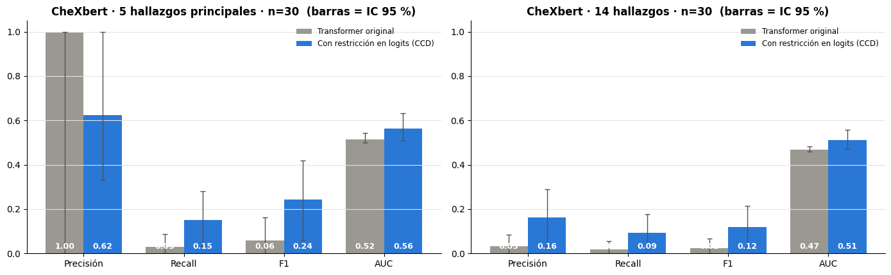
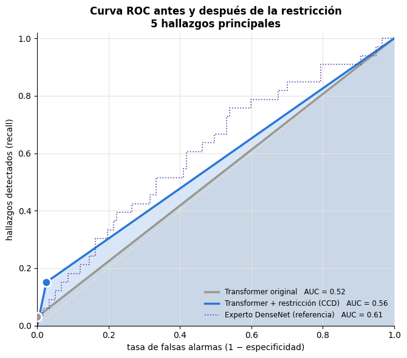
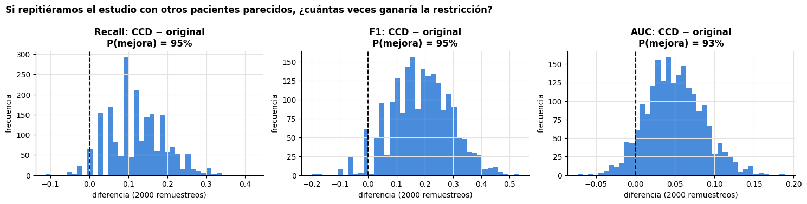
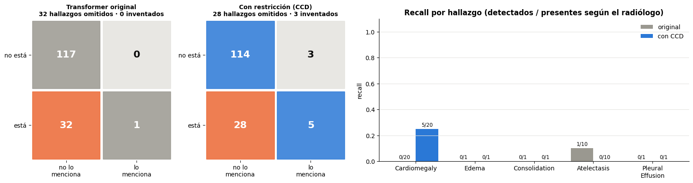
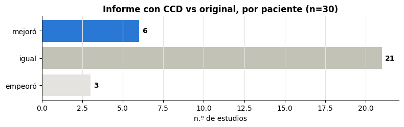
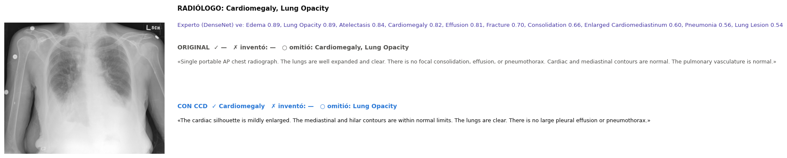

# Incorporación de restricciones a modelos de aprendizaje automático

Exposición y repositorio de implementación sobre cómo **incorporar restricciones** en modelos de aprendizaje automático, con énfasis en **Transformers** y en restricciones aplicadas **después del entrenamiento**, directamente sobre los **logits** durante la inferencia.

**Caso principal:** un Transformer multimodal (MAIRA-2, 7 B parámetros, pesos congelados) que redacta informes de radiografías de tórax. Le aplicamos **Clinical Contrastive Decoding (CCD, ACL 2026)**, una restricción que corrige sus logits palabra a palabra usando la evidencia de un modelo experto que mira la misma imagen. **Sin reentrenar ni un solo peso**, el modelo pasa a mencionar hallazgos que antes omitía.

> Demostración académica. No es una herramienta clínica.

---

## Contenido

| Carpeta | Qué hay |
|---|---|
| [`presentacion/`](presentacion/Incorporacion_de_restricciones_en_modelos_de_aprendizaje_automatico.pdf) | **Diapositivas de la exposición** (PDF, 26 páginas) |
| [`notebooks/ccd_radiologia_maira2.ipynb`](notebooks/ccd_radiologia_maira2.ipynb) | **Implementación principal**, ya ejecutada y comentada: instalación, datos, generación con/sin restricción, evaluación clínica y gráficas. Las celdas **B → H** cargan los resultados desde este repositorio y corren sin GPU |
| [`figuras/`](figuras/) | Figuras del experimento principal |
| [`resultados/`](resultados/) | Tablas de métricas y [`ccd_demo/`](resultados/ccd_demo/): informes generados, etiquetas CheXbert y radiografías (lo que usan las celdas B → H) |
| [`experimentos_previos/`](experimentos_previos/) | Lo que probamos antes y **no** funcionó (o funcionó en otro dominio): código, descarga de datos, `requirements.txt` y salida esperada |

---

## 1. Fundamentos: ¿qué es una restricción?

Una restricción le dice al modelo **qué no puede hacer** (o qué debe cumplir siempre): una regla del dominio que el modelo, por sí solo, no garantiza. La idea central de la exposición:

> **Restringir lo irrelevante libera capacidad para lo relevante.** Una restricción no le enseña nada nuevo al modelo: le quita direcciones que no aportan. Por eso ayuda **exactamente en la medida en que el modelo viola esa regla**.

### Dónde se puede incorporar

| Momento | Tipo | Ejemplos |
|---|---|---|
| **Datos** | blanda | aumento de datos (rotaciones, color) |
| **Arquitectura** | dura | convoluciones (invariancia a traslaciones), redes equivariantes a rotaciones (Veeling et al., 2018; Romero & Cordonnier, 2021), ConViT (localidad en la atención) |
| **Función de pérdida** | blanda | penalizaciones / multiplicadores de Lagrange, regularización, recompensas en RL (Miura et al., 2021) |
| **Inferencia (post-entrenamiento)** | dura o blanda | **decodificación restringida**: enmascarar o sesgar logits (Hokamp & Liu, 2017; PICARD, 2021; Geng et al., 2023; **CCD, 2026**), promediar sobre un grupo de simetrías, umbrales con garantías (Neyman-Pearson / conformal) |

- **Dura:** se cumple siempre por construcción (p. ej. un logit puesto en −∞ nunca se genera).
- **Blanda:** se favorece pero puede violarse (p. ej. un sesgo finito sobre el logit).

### En un Transformer, ¿por qué los logits?

En cada paso, un Transformer generativo produce un vector de **logits** $z_t \in \mathbb{R}^{|V|}$ (una puntuación por cada palabra del vocabulario) y elige la siguiente palabra con $\mathrm{softmax}(z_t)$. Intervenir $z_t$ antes del softmax permite imponer reglas **sin tocar los pesos**:

- **Máscara (dura):** $z_t[v] \leftarrow -\infty$ para las palabras prohibidas.
- **Sesgo (blanda):** $z_t[v] \leftarrow z_t[v] + b_v$ con $b_v$ calculado a partir de evidencia externa.

---

## 2. Caso de estudio: CCD sobre un Transformer radiológico

**Problema.** Los Transformers que redactan informes radiológicos tienden a escribir el informe "típico" (*"los pulmones están limpios…"*) y **omiten hallazgos** que sí están en la imagen. Esto es lo que se conoce como alucinación clínica por omisión (Miura et al., 2021).

**Restricción (CCD, Zhang et al., ACL 2026).** Un modelo experto (DenseNet-121 entrenado en CheXpert, de `torchxrayvision`) mira la radiografía y estima la probabilidad $p_c$ de cada hallazgo $c$. CCD usa esa evidencia en dos etapas, en cada palabra generada:

1. **Guía clínica:** se corre el Transformer dos veces, una con la instrucción original y otra a la que se le añaden los hallazgos del experto, y se mezclan sus log-probabilidades:
   $\ell^{\text{guía}} = (1-\alpha)\,\ell^{\text{orig}} + \alpha\,\ell^{\text{clínico}}$
2. **Sesgo experto sobre los logits** de las palabras de cada hallazgo (p. ej. *cardiomegaly*, *effusion*):
   $b_c = \mathrm{clip}\big(\log\tfrac{p_c}{1-p_c},\ -\log\gamma,\ \log\gamma\big)$,
   $\ell^{\text{final}} = (1-\beta)\,\ell^{\text{guía}} + \beta\,(\ell^{\text{guía}} + b)$

Si el experto ve cardiomegalia ($p_c$ alta), la palabra *cardiomegaly* sube; si no la ve, baja. El acotamiento con $\gamma$ hace que sea una restricción **blanda**: el Transformer conserva la última palabra. Usamos los parámetros del paper: $\alpha=\beta=0.5$, $\gamma=10$, decodificación greedy.

### Configuración del experimento

| | |
|---|---|
| Transformer | **MAIRA-2** (Microsoft), versión adaptada por los autores de CCD: `X-iZhang/libra-maira-2` |
| Experto | DenseNet-121 CheXpert (`torchxrayvision`) |
| Datos | **IU X-Ray** (Indiana University, acceso libre): `X-iZhang/IU-Xray-RRG`, sección *findings*, radiografías frontales |
| Muestra | 30 estudios **con al menos uno de los 5 hallazgos principales** según el informe del radiólogo (40 de 237 en el fragmento usado; selección aleatoria con semilla fija) |
| Evaluación | **CheXbert** (Smit et al., 2020) etiqueta 14 hallazgos en el informe generado y en el del radiólogo → precisión, recall, F1 (micro) y AUC; IC 95 % por *bootstrap* pareado (2000 remuestreos) |
| Hardware | Google Colab, GPU A100 40 GB · ~1,4 s por informe sin restricción, **~11,5 s con CCD** |

> **¿Por qué estudios con hallazgos?** En una muestra aleatoria de 20 estudios casi todos eran normales: ambas versiones decían "normal" y las métricas eran idénticas. CCD solo puede marcar diferencia cuando hay algo que detectar. El paper evalúa sobre los 3307 estudios del conjunto de prueba.

---

## 3. Resultados

### Métricas (n = 30 estudios con hallazgos)

**5 hallazgos principales** (cardiomegalia, edema, consolidación, atelectasia, derrame pleural):

| Métrica | Transformer original | **+ CCD** | Δ (IC 95 %) | P(mejora)* |
|---|---|---|---|---|
| Precisión | 1,000 | 0,625 | [−0,667, +0,875] | 37 % |
| **Recall** | 0,030 | **0,152** | [+0,000, +0,267] | 95 % |
| **F1** | 0,059 | **0,244** | [−0,011, +0,391] | 95 % |
| AUC | 0,515 | 0,563 | [−0,015, +0,122] | 93 % |

**14 hallazgos CheXbert:**

| Métrica | Transformer original | **+ CCD** | Δ (IC 95 %) | P(mejora)* |
|---|---|---|---|---|
| **Precisión** | 0,031 | **0,161** | [+0,002, +0,269] | 98 % |
| **Recall** | 0,019 | **0,094** | [+0,000, +0,167] | 95 % |
| **F1** | 0,024 | **0,119** | [+0,001, +0,205] | 98 % |
| **AUC** | 0,467 | **0,512** | [+0,003, +0,092] | 98 % |

\* Proporción de remuestreos *bootstrap* en que CCD supera al original.

**Referencia del paper** (MAIRA-2, IU X-Ray, 3307 estudios): CheXbert-F1 5 hallazgos **4,02 → 19,96**; 14 hallazgos 24,14 → 28,23; RadGraph-F1 16,52 → 21,12. Nuestro resultado va en la **misma dirección y con magnitud comparable** en los 5 hallazgos principales.

*El Transformer produce texto: para cada hallazgo solo "lo menciona" o "no lo menciona". Por eso su curva ROC es la recta (0,0) → (tasa de falsas alarmas, recall) → (1,1), y su AUC es (sensibilidad + especificidad)/2. El experto (punteado) sí da probabilidades continuas.*

### Un caso

El radiólogo reporta cardiomegalia y opacidad pulmonar. El Transformer original escribe un informe normal. Con CCD, guiado por el experto, escribe *"the cardiac silhouette is mildly enlarged"* (cardiomegalia). Más casos en [`figuras/`](figuras/).

### Lectura honesta

- **La mejora es real pero concentrada:** de los 5 hallazgos principales, la ganancia viene casi toda de **cardiomegalia** (0/20 → 5/20 detectadas). La atelectasia empeoró (1/10 → 0/10), y edema, consolidación y derrame tenían un solo caso cada uno.
- **Recall a cambio de algo de precisión:** en 5 hallazgos los aciertos pasan de 1 a 5 y los hallazgos inventados de 0 a 3. La precisión 1,000 del original engaña: menciona un solo hallazgo en 30 estudios.
- **Por paciente:** mejoró 6, igual 21, empeoró 3.
- **n = 30 es poco:** los intervalos son amplios. En 14 hallazgos, precisión, F1 y AUC excluyen el cero y el recall lo toca; en 5 hallazgos el de recall toca el cero y los de F1 y AUC lo incluyen por poco.
- **El techo lo pone el experto:** el DenseNet tiene AUC 0,61 en estos 30 estudios. Con un experto mejor, CCD tiene más margen.

---

## 4. Casos de uso reales del enfoque

| Dominio | Restricción en inferencia | Referencia |
|---|---|---|
| Texto a SQL | Descartar tokens que producirían SQL inválido durante el *beam search* | PICARD (Scholak et al., EMNLP 2021) |
| Traducción con terminología obligatoria | Forzar que ciertas palabras aparezcan en la salida | Grid Beam Search (Hokamp & Liu, ACL 2017) |
| Extracción de información / salidas JSON | Enmascarar logits con una gramática formal | Geng et al., EMNLP 2023; "structured outputs" de los proveedores de LLM |
| Informes radiológicos | Sesgar logits con un experto clínico | **CCD (Zhang et al., ACL 2026)**, este repositorio |
| Patología digital | Invariancia a rotaciones (en la arquitectura) | Veeling et al., MICCAI 2018; Romero & Cordonnier, ICLR 2021 |

---

## 5. Experimentos previos: cuándo una restricción **no** ayuda

Antes de llegar a CCD probamos restricciones post-entrenamiento sobre **BiomedCLIP** (Vision Transformer biomédico) para detectar metástasis en **PatchCamelyon**. Todo está en [`experimentos_previos/`](experimentos_previos/).

| Restricción post-entrenamiento | Resultado (AUC salvo indicación) |
|---|---|
| Invariancia a rotaciones/reflexiones (promedio sobre el grupo D4) | 0,825 → 0,832 (mitad de prueba, 500 parches), IC del Δ [−0,007, +0,021]; mejora pequeña pero en 10/10 particiones. Lleva al **0 %** los parches cuyo diagnóstico cambiaba al girarlos (antes **30,6 %**); κ de Fleiss entre orientaciones 0,74 → 1,00 |
| Normalización de la tinción H&E | 0,810 → **0,738** (empeora) |
| Mirar solo el centro del parche (64 / 48 px) | 0,798 → 0,780 / 0,760 (empeora) |
| Transducción TransCLIP / Histo-TransCLIP (código oficial) | 0,810 → 0,765 / 0,644 (empeora) |
| Alineación entre hospitales (CORAL, Camelyon17-WILDS) | el modelo **no** empeoraba en el hospital nuevo (0,951 → 0,962): no había nada que corregir |

**Lección:** BiomedCLIP ya había aprendido esas invariancias con millones de imágenes, así que las restricciones no tenían falla que corregir (giro) o eliminaban información útil (color, contexto). **Una restricción vale lo que vale la ignorancia del modelo sobre esa regla.**

**Contraste con un LLM** (`experimentos_previos/llm_permutaciones/`): Qwen2.5-0.5B en 60 preguntas médicas de opción múltiple (MMLU *clinical knowledge*) sí viola la regla "el orden de las opciones no importa": elige "B" el 42 % de las veces y "A" el 5 %, y cambia de respuesta en el 83 % de las preguntas al reordenarlas. Imponer la invariancia (promediar sobre las 4 rotaciones cíclicas de las opciones) sube la exactitud **0,462 → 0,583** (IC del Δ [+0,033, +0,208]) y el F1 macro 0,433 → 0,576.

---

## 6. Ventajas, desventajas y recomendaciones

**Ventajas**
- **Cero entrenamiento:** no se tocan los pesos. Sirve con modelos cerrados o demasiado grandes para reentrenar (MAIRA-2 tiene 7 B parámetros).
- **Modular:** el experto, la regla o la gramática se cambian sin tocar el modelo base.
- **Interpretable y auditable:** se sabe exactamente qué regla se impuso y con qué fuerza ($\alpha$, $\beta$, $\gamma$).
- **Las restricciones duras dan garantías** (formato válido, invariancia exacta).

**Desventajas**
- **Costo en inferencia:** CCD pasa de ~1,4 s a ~11,5 s por informe (dos pasadas del modelo por palabra; la implementación oficial además no reutiliza la caché de atención).
- **Hereda los errores del experto:** si el experto se equivoca, empuja al Transformer en la dirección equivocada (aquí el experto tiene AUC 0,61).
- **Restringir lo relevante destruye información** (tinción, centro del parche en los experimentos previos).
- **Consistencia ≠ exactitud:** una invariancia exacta puede no mover la exactitud si el modelo ya era casi invariante.
- Requiere **acceso a los logits** (no sirve con APIs que solo devuelven texto).

**Recomendaciones**
1. **Primero medir si el modelo viola la regla** (p. ej. tasa de cambio de predicción al aplicar la simetría). Si no la viola, la restricción no ayudará.
2. Restringir solo dimensiones **verdaderamente irrelevantes** para la tarea.
3. Preferir restricciones **blandas y acotadas** (como $\gamma$ en CCD) cuando la fuente de la regla es imperfecta.
4. Reportar métricas estándar con **intervalos de confianza** y el balance completo (casos que mejoran **y** que empeoran).
5. Evaluar en muestras donde la restricción **puede** actuar (aquí, estudios con hallazgos), y declararlo.

---

## 7. Cómo reproducir

1. Abre el notebook con el botón **Abrir en Colab** y elige **GPU A100** (L4 también funciona, pero es más lenta; una T4 de 16 GB no alcanza para MAIRA-2).
2. Celda 1: instalación (~3–4 min). La sesión **se reinicia sola**; luego sigue desde la celda 2, **sin volver a la 1**.
3. Celdas 2 → 4: datos, selección de estudios con hallazgos, carga del modelo y generación (~6 min para 30 estudios en A100).
4. Celdas 5 → H: evaluación y gráficas. Las celdas **A/B** guardan y cargan los resultados desde Google Drive, para no recalcular.

### Versiones usadas

| Componente | Versión |
|---|---|
| Entorno | Google Colab, Python 3.13, GPU NVIDIA A100 40 GB |
| PyTorch | 2.11.0 + CUDA 13.0 (el de Colab) |
| transformers / tokenizers / accelerate | 4.51.3 / 0.21.1 / 1.6.0 |
| Libra (base de CCD) | v1.0.3 |
| CCD | commit [`8cefd7f`](https://github.com/X-iZhang/CCD/tree/8cefd7fcd2f222cfb102e1e33b3918bf98ad6d4e) |
| f1chexbert (CheXbert) | 0.0.2 |
| Datos | `X-iZhang/IU-Xray-RRG`, `findings_section/test-00000-of-00014.parquet` (237 estudios) |

La generación es *greedy* (determinista) y la selección de estudios y el *bootstrap* usan semillas fijas. Los experimentos previos tienen su propio [`requirements.txt`](experimentos_previos/requirements.txt) e instrucciones en [`experimentos_previos/README.md`](experimentos_previos/README.md).

**Notas de compatibilidad (Colab, Python 3.13):** Libra fija `torch==2.4.0`, que no existe para Python 3.13, así que se instala con `--no-deps` sobre el torch de Colab y con `transformers==4.51.3`. Además se define `USE_TF=0` para que transformers no cargue TensorFlow (choca con protobuf), y se copia el checkpoint de CheXbert a la ruta que espera `f1chexbert`.

---

## 8. Referencias

- Zhang, X., Meng, Z., Lever, J., & Ho, E. S. L. (2026). *CCD: Mitigating Hallucinations in Radiology MLLMs via Clinical Contrastive Decoding.* ACL 2026. [arXiv:2509.23379](https://arxiv.org/abs/2509.23379) · [código](https://github.com/X-iZhang/CCD)
- Miura, Y., Zhang, Y., Tsai, E. B., Langlotz, C. P., & Jurafsky, D. (2021). *Improving Factual Completeness and Consistency of Image-to-Text Radiology Report Generation.* NAACL 2021. [ACL Anthology](https://aclanthology.org/2021.naacl-main.416/)
- Smit, A., et al. (2020). *CheXbert: Combining Automatic Labelers and Expert Annotations for Accurate Radiology Report Labeling Using BERT.* EMNLP 2020.
- Hokamp, C., & Liu, Q. (2017). *Lexically Constrained Decoding for Sequence Generation Using Grid Beam Search.* ACL 2017.
- Scholak, T., Schucher, N., & Bahdanau, D. (2021). *PICARD: Parsing Incrementally for Constrained Auto-Regressive Decoding from Language Models.* EMNLP 2021.
- Geng, S., Josifoski, M., Peyrard, M., & West, R. (2023). *Grammar-Constrained Decoding for Structured NLP Tasks without Finetuning.* EMNLP 2023.
- Veeling, B. S., Linmans, J., Winkens, J., Cohen, T., & Welling, M. (2018). *Rotation Equivariant CNNs for Digital Pathology.* MICCAI 2018.
- Romero, D. W., & Cordonnier, J.-B. (2021). *Group Equivariant Stand-Alone Self-Attention for Vision.* ICLR 2021.
- d'Ascoli, S., et al. (2021). *ConViT: Improving Vision Transformers with Soft Convolutional Inductive Biases.* ICML 2021.
- Zanella, M., Gérin, B., & Ben Ayed, I. (2024). *Boosting Vision-Language Models with Transduction (TransCLIP).* NeurIPS 2024.
- Zheng, C., et al. (2024). *Large Language Models Are Not Robust Multiple Choice Selectors.* ICLR 2024.
- Zhang, S., et al. (2023). *BiomedCLIP.* Microsoft. · Bannur, S., et al. (2024). *MAIRA-2.* Microsoft.
- Datos: IU X-Ray / Open-i (Demner-Fushman et al., 2016); PatchCamelyon (Veeling et al., 2018); Camelyon17-WILDS (Koh et al., 2021).

---

## Equipo

- Manuela Rendón Sepulveda
- Luciana Núñez Ospina
- Cristian Miguel Gómez Salazar
- Santiago Alberto Vélez Casallas

## Licencia

Código bajo licencia MIT (ver [`LICENSE`](LICENSE)). Los modelos y datos de terceros conservan sus propias licencias.
